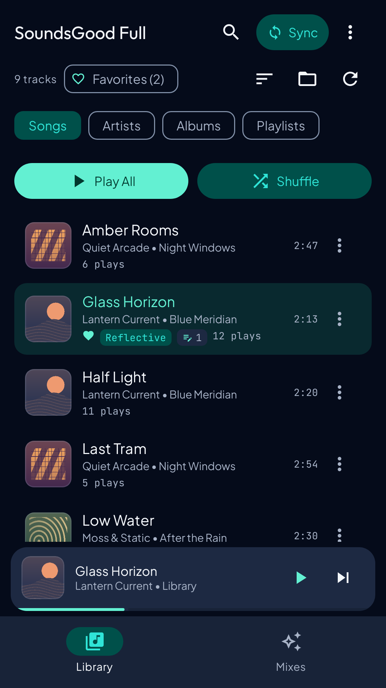
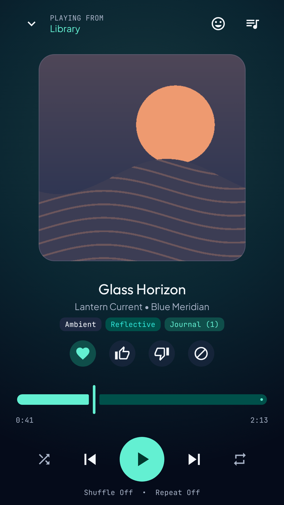
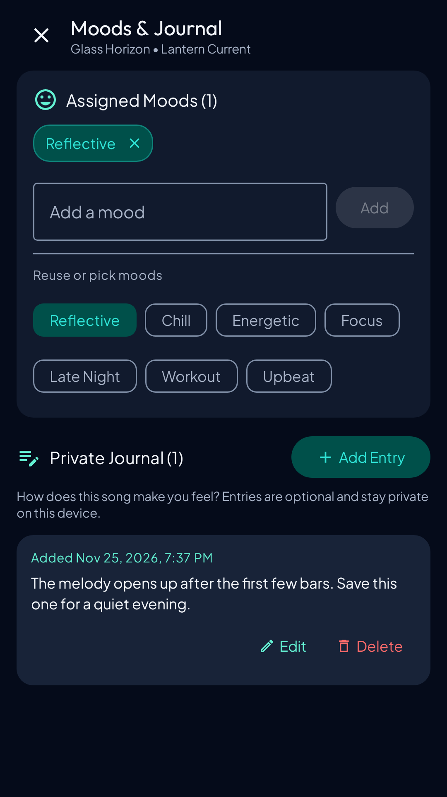

# SoundsGood Personal Edition

Build your own free Android music player for personal, noncommercial use. This repository contains **Personal Edition** (`com.aistudio.soundsgood.kxmprz`), not the commercial **SoundsGood Full** app on Google Play. **SoundsGood Sync** is the separate free Mac companion linked below. No Personal APK is distributed here.

## Build and run Personal Edition

Install Android Studio with support for Android Gradle Plugin 9.4.1 (tested with Studio 2026.2.2 and its bundled JDK 25). In SDK Manager install Android SDK Platform **36.1**, Build-Tools **36.0.0**, and Platform-Tools. For a test device use Android 7.0 (API 24) or newer. First-time setup needs internet access for Gradle and dependencies; no Firebase project, API keys, `.env`, publisher keystore, or separate Gradle installation is required.

```sh
git clone https://github.com/sulaimonao/SoundsGood.git
cd SoundsGood
```

**Android Studio:** Open the cloned directory containing `settings.gradle.kts`, use the project's Gradle wrapper and the bundled Gradle JDK, and let sync finish. Select the **app** configuration and a fresh emulator in Device Manager, then click **Run**.

**Command line:** Set `JAVA_HOME` to your Gradle JDK and `ANDROID_HOME` to your Android SDK. From the repository root:

```sh
./gradlew :app:assembleDebug
./gradlew :app:testDebugUnitTest
```

On Windows use `gradlew.bat` instead of `./gradlew`. The debug APK is `app/build/outputs/apk/debug/app-debug.apk`. Android tooling signs it with your local debug key, generated on first use. Do not share that key.

To install without replacing an existing app, choose a **fresh emulator**, run `adb devices`, and substitute its serial for `SERIAL`:

```sh
adb -s SERIAL install app/build/outputs/apk/debug/app-debug.apk
```

Open **SoundsGood** from the launcher, grant the requested music access, and play an audio file you own. Do not uninstall an existing Personal installation or use `-r` to resolve a signing conflict; choose a different emulator instead. With a disposable emulator as your only connected device, `./gradlew :app:connectedDebugAndroidTest` runs the device tests.

The [Personal Use Only License](LICENSE) permits free local builds, use and private modifications for your own noncommercial purposes. It preserves GitHub platform rights; other redistribution or commercial use requires separate permission, subject to the exceptions in the license. Keep the [third-party notices](THIRD_PARTY_NOTICES.md) with your copy. The Gradle wrapper is distributed under [Apache License 2.0](docs/licenses/Apache-2.0.txt).

## 🎵 Get early access to SoundsGood Full

**Your music. Your library. Your way.**

Discover a more personal music experience with smart playlists, listening statistics, mood tagging, music journals and offline playback.

**$4.99 — one-time purchase. No ads. No subscriptions.**

  

## Join the Google Play closed test

1. [Join our Discord community](https://discord.gg/7jYxyyqHm) and privately message the server owner with your Google Play email address to request beta access. Please don’t post your email in a public channel or GitHub issue.
2. Once added, join the closed test on the web. Then open Google Play on Android using that same account to install SoundsGood Full.
3. Stay enrolled for at least **14 consecutive days**, enjoy the app and share your feedback.

[](https://play.google.com/apps/testing/com.sulaimonao.soundsgood.full) [](https://play.google.com/store/apps/details?id=com.sulaimonao.soundsgood.full)

Your support helps shape the future of SoundsGood.

## SoundsGood Sync for Mac

Transfer your selected music and playlists over local Wi-Fi or export a transfer folder for USB. [Download SoundsGood Sync 0.3.2 (build 7) for Mac](https://github.com/sulaimonao/SoundsGood/releases/download/mac-sync-v0.3.2/SoundsGoodSync-0.3.2-build7-macOS-universal.zip). The free ZIP contains a signed and notarized app for Intel and Apple silicon Macs running macOS 13 or later. [SHA-256 checksum](https://github.com/sulaimonao/SoundsGood/releases/download/mac-sync-v0.3.2/SHA256SUMS.txt) · [Installation and setup](https://sulaimonao.github.io/SoundsGood/mac-companion.html).

## Editions, privacy and support

- [SoundsGood Full Privacy Policy](https://sulaimonao.github.io/SoundsGood/full-privacy.html) · [Full Terms of Service](https://sulaimonao.github.io/SoundsGood/full-terms.html) · [Support](https://sulaimonao.github.io/SoundsGood/support.html)
- SoundsGood Full is a separate commercial product. Its source and signing keys are not distributed here.
- Existing Personal Edition material remains subject to its [Personal Use Only License](LICENSE), [privacy policy](docs/personal-privacy.html) and [third-party notices](THIRD_PARTY_NOTICES.md). The Personal license does not cover SoundsGood Full or change third-party rights.
